# CYLOO — Intelligent Business Platform Architecture

## Executive Overview
**CYLOO** is an AI-first, multi-tenant enterprise CRM designed specifically for the UAE, Saudi Arabia, and broader GCC markets with native English and Arabic (RTL) capabilities.
- **Tenant Model**: Strict tenant isolation via a shared database architecture using `tenant_id` foreign keys, PostgreSQL Row-Level Security (RLS) policies (`app.tenant_id` GUC scoping), and tenant-scoped application authorization.
- **Architecture**: Modular monolith backend (NestJS 11), responsive Next.js 15 App Router web interface, FastAPI AI routing service, and versioned Supabase PostgreSQL migrations.

```
┌─────────────────────────────────────────────────────────────┐
│                   CYLOO Web (Next.js 15)                    │
│   App Router, React 19, Tailwind CSS, Arabic RTL Support    │
└──────────────┬───────────────────────────────┬──────────────┘
               │ BFF / REST                    │
               ▼                               ▼
┌──────────────────────────────┐ ┌────────────────────────────┐
│      CYLOO API (NestJS 11)   │ │  AI Gateway (FastAPI 8100) │
│ - Modular Monolith Domain    │ │ - Multilingual RAG         │
│ - Tenancy & Zero-Trust RBAC  │ │ - Model Provider Gateway   │
│ - Parameterized Repositories │ │ - Tool Governance          │
└──────────────┬───────────────┘ └─────────────┬──────────────┘
               │                               │
               ▼                               ▼
┌─────────────────────────────────────────────────────────────┐
│             Supabase PostgreSQL 16 + pgvector               │
│ - 111 Tables, 85 Runtime Registrations                      │
│ - Row-Level Security (RLS) on all tenant-owned entities     │
│ - Versioned Migrations (0001_init to 0004_zero_trust)      │
└─────────────────────────────────────────────────────────────┘
```

---

## Architectural Decision Records (ADRs)

### ADR-0001: Tenancy & Zero-Trust Isolation
- **Decision**: Multi-tenancy enforced at both database (RLS) and application (TenancyService) layers.
- **Context**: In multi-tenant GCC enterprise software, cross-tenant data leakage is catastrophic. Every query and mutation scopes by `tenant_id`.
- **Database Enforcement**: `current_tenant_id()` resolves `app.tenant_id` GUC. All tenant tables require `FORCE ROW LEVEL SECURITY`.
- **Application Enforcement**: `TenancyService.filterByScope`, `requirePerm`, `requireSensitivePermission`.

### ADR-0002: Modular Monolith API Architecture
- **Decision**: NestJS 11 TypeScript API organized into cohesive domain modules (`crm`, `leads`, `sales`, `inbox`, `ai`, `marketing`, `scheduling`, `service`, `commerce`, `ops`, `platform`, `social`, `workflow`).
- **Rationale**: Balances bounded context isolation with atomic transactions and single-binary deployment.

### ADR-0003: Dual Persistence Strategy (MemoryStore Double + PostgresStore Adapter)
- **Decision**: `TenantStore` defines transactional boundaries and atomic execution.
  - `MemoryStore`: In-process serialized test double for unit/contract tests without external DB dependencies.
  - `PostgresStore`: Production adapter with connection pooling, parameterized SQL, RLS GUC scoping (`SET LOCAL app.tenant_id = $1`), and optimistic locking via `row_version`.
- **Safety Gate**: Production startup immediately fails closed if `NODE_ENV === 'production'` and `DATABASE_URL` is absent.

### ADR-0004: GCC Localization & Financial Compliance
- **Decision**: Strict separation of currency minor units and dynamic VAT versioning.
  - Currencies: 2 decimal places (`AED`, `SAR`, `QAR`), 3 decimal places (`KWD`, `BHD`, `OMR`).
  - Tax engine: Versioned tax rates with effective dates (`tax_rate_versions`). Every quote and invoice snapshots the exact tax rate applied.

### ADR-0005: Governed AI Tool Execution
- **Decision**: AI agent tools execute strictly within the authenticated caller's security context.
  - Model claims are ignored; server-side permission re-checks are enforced (`def.perm`, `sensitive.customer.read`, `sensitive.finance.read`).
  - Outbound actions (e.g. `external.send_email`) require approval bound to the SHA-256 hash of the exact payload.
  - Retrieval-Augmented Generation (RAG) enforces tenant-scoping and document permissions prior to similarity ranking.

---

## Entity Relationship Diagram (ERD)

```mermaid
erDiagram
  tenants ||--o{ memberships : contains
  tenants ||--o{ departments : organizes
  tenants ||--o{ teams : organizes
  departments ||--o{ teams : contains
  teams ||--o{ team_memberships : includes
  memberships ||--o{ team_memberships : assigned_to

  tenants ||--o{ companies : owns
  tenants ||--o{ contacts : owns
  companies ||--o{ contacts : associates
  tenants ||--o{ leads : owns
  contacts ||--o{ leads : converts_from

  tenants ||--o{ pipelines : owns
  pipelines ||--o{ pipeline_stages : defines
  tenants ||--o{ opportunities : owns
  pipeline_stages ||--o{ opportunities : tracks

  tenants ||--o{ quotes : owns
  quotes ||--o{ quote_lines : contains
  tenants ||--o{ invoices : bills
  invoices ||--o{ invoice_lines : contains

  tenants ||--o{ channels : configures
  channels ||--o{ conversations : receives
  conversations ||--o{ messages : contains

  tenants ||--o{ ai_conversations : owns
  ai_conversations ||--o{ ai_messages : contains
  ai_conversations ||--o{ agent_runs : executes
  tenants ||--o{ agents : configures

  tenants ||--o{ workflows : owns
  workflows ||--o{ workflow_versions : versions
  workflow_versions ||--o{ workflow_runs : runs
  workflow_runs ||--o{ workflow_steps : logs

  tenants ||--o{ staff : employs
  staff ||--o{ availability_rules : schedules
  staff ||--o{ appointments : attends

  tenants ||--o{ tickets : owns
  tickets ||--o{ ticket_comments : contains
  tickets ||--o{ sla_policies : governed_by

  tenants ||--o{ campaigns : owns
  campaigns ||--o{ audiences : targets
  campaigns ||--o{ campaign_sends : dispatches

  tenants ||--o{ outbound_webhooks : configures
  outbound_webhooks ||--o{ webhook_deliveries : tracks

  tenants ||--o{ dsar_requests : processes
  tenants ||--o{ audit_events : logs
```



---

## 30-Module Traceability Matrix

| # | Module Name | Primary Entities | API Module | Status |
|---|---|---|---|---|
| 01 | Customer 360 | `contacts`, `companies`, `custom_field_definitions`, `custom_field_values` | `crm.module.ts` | Fully Implemented & Tested |
| 02 | Lead Management | `leads`, `lead_sources`, `scoring_rules`, `routing_rules` | `leads.module.ts` | Fully Implemented & Tested |
| 03 | Sales Pipeline | `pipelines`, `pipeline_stages`, `opportunities` | `sales.module.ts` | Fully Implemented & Tested |
| 04 | Sales Enablement & Quotes | `quotes`, `quote_lines`, `quote_versions`, `approvals` | `sales.module.ts` | Fully Implemented & Tested |
| 05 | Account & Territory | `companies`, `departments`, `teams`, `territories` | `crm.module.ts`, `platform.module.ts` | Fully Implemented & Tested |
| 06 | Unified Inbox | `conversations`, `messages`, `channels` | `inbox.module.ts` | Fully Implemented & Tested |
| 07 | WhatsApp Cloud Automation | `channels`, `message_templates`, `webhook_events` | `inbox.module.ts` | Fully Implemented (Contract) / Blocked (Credentials) |
| 08 | Social Communication | `social_posts`, `channels`, `provider_accounts` | `social.module.ts` | Fully Implemented (Contract) / Blocked (App Review) |
| 09 | Email, SMS & Voice | `messages`, `suppressions`, `consents`, `delivery_receipts` | `inbox.module.ts` | Fully Implemented (Contract) / Blocked (Credentials) |
| 10 | AI Agent Studio | `agents`, `agent_versions`, `agent_runs`, `tool_invocations` | `ai.module.ts` | Fully Implemented & Tested |
| 11 | AI Multilingual Voice Hub | `ai_conversations`, `ai_messages`, `ai_budgets` | `ai.module.ts` | Fully Implemented (Local) / Blocked (Twilio/SIP) |
| 12 | Workflow Automation Engine | `workflows`, `workflow_versions`, `workflow_runs`, `workflow_steps` | `workflow.module.ts` | Fully Implemented & Tested |
| 13 | Predictive Intelligence & Insights | `agent_runs`, `attribution_touches`, `scoring_rules` | `ai.module.ts` | Fully Implemented & Tested |
| 14 | Marketing Campaigns & A/B | `campaigns`, `audiences`, `campaign_sends` | `marketing.module.ts` | Fully Implemented & Tested |
| 15 | Social Content Calendar | `social_posts`, `approvals` | `social.module.ts` | Fully Implemented & Tested |
| 16 | Advertising Attribution | `attribution_touches`, `leads`, `opportunities` | `marketing.module.ts` | Fully Implemented & Tested |
| 17 | Landing Pages & Forms | `leads`, `custom_field_values` | `leads.module.ts`, `web` | Fully Implemented & Tested |
| 18 | Helpdesk & SLA Engine | `tickets`, `ticket_comments`, `sla_policies`, `queues` | `service.module.ts` | Fully Implemented & Tested |
| 19 | Scheduling & Appointments | `staff`, `availability_rules`, `booking_pages`, `appointments` | `scheduling.module.ts` | Fully Implemented & Tested |
| 20 | Tasks & Project Operations | `tasks`, `notifications`, `approvals` | `ops.module.ts`, `workflow.module.ts` | Fully Implemented & Tested |
| 21 | Customer Self-Service Portal | `portal_accounts`, `portal_grants`, `tickets` | `service.module.ts` | Fully Implemented & Tested |
| 22 | Commerce Orders & Catalog | `products`, `invoices`, `invoice_lines` | `commerce.module.ts` | Fully Implemented & Tested |
| 23 | Billing & Subscriptions | `invoices`, `payment_links`, `gateway_events`, `tax_rate_versions` | `commerce.module.ts` | Fully Implemented & Tested |
| 24 | Revenue Analytics & LTV | `invoices`, `opportunities`, `quote_lines` | `sales.module.ts`, `commerce.module.ts` | Fully Implemented & Tested |
| 25 | Multi-Tenant SaaS Engine | `tenants`, `memberships`, `roles`, `usage_events` | `app.module.ts`, `platform.module.ts` | Fully Implemented & Tested |
| 26 | Super Admin & White-Label | `resellers`, `tenant_domains`, `api_keys` | `platform.module.ts` | Fully Implemented & Tested |
| 27 | Security & Privacy (DSAR) | `dsar_requests`, `audit_events`, `activity_events` | `platform.module.ts` | Fully Implemented & Tested |
| 28 | Integrations & Developer Hub | `api_keys`, `outbound_webhooks`, `webhook_deliveries` | `platform.module.ts` | Fully Implemented & Tested |
| 29 | GCC Regional Localization | `tax_rate_versions`, `number_sequences`, `shared/money` | `shared`, `commerce.module.ts` | Fully Implemented & Tested |
| 30 | Industry Extension Packs | `custom_field_definitions`, `industry_templates` | `platform.module.ts` | Fully Implemented & Tested |
