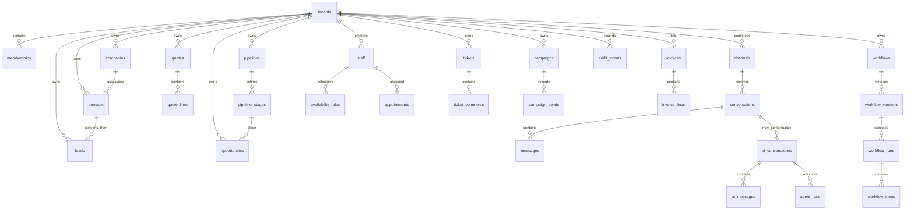

# Conceptual ERD (current SQL plus identified gaps)

This diagram summarizes core SQL relationships, not every column or an
assertion that runtime persistence is implemented. Relationships drawn as
tenant-owned should be strengthened with tenant-aware composite constraints
where the parent is tenant-owned.

Migration 0003 adds the tenant-scoped AI conversation and message relations
and uses `agent_runs` as the canonical run entity. Composite AI conversation
and message relationships are declared in SQL. This ERD describes source
migrations only; those migrations have not been executed against PostgreSQL.

Additional integrity issue: existing SQL foreign keys often reference
single-column IDs without `(tenant_id, parent_id)` constraints. Tenant RLS on
each table does not by itself ensure a child points to a parent in the same
tenant.
